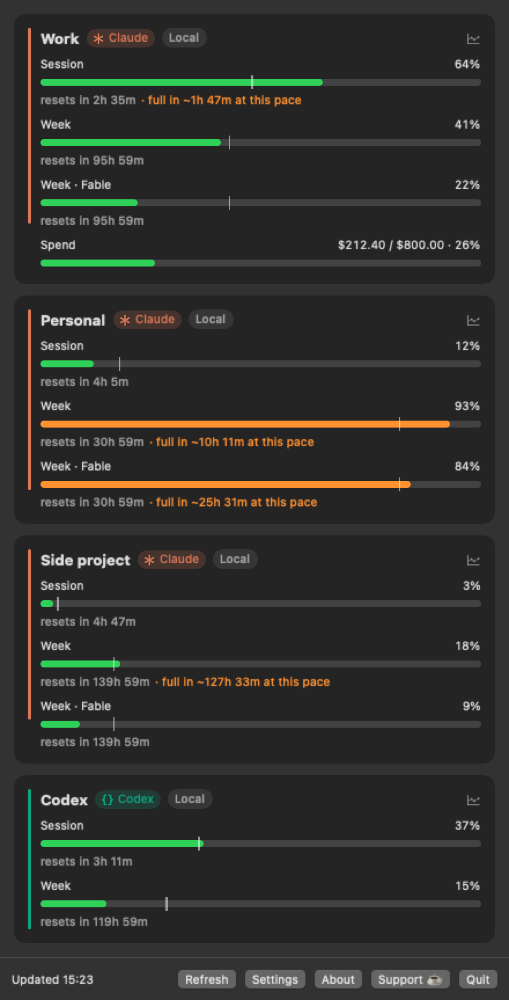
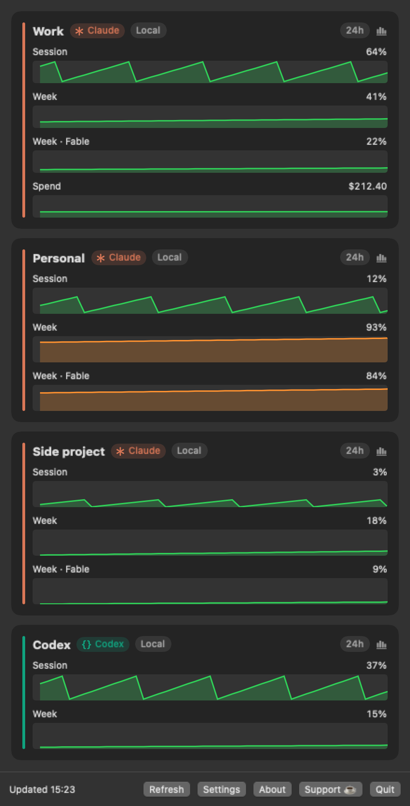
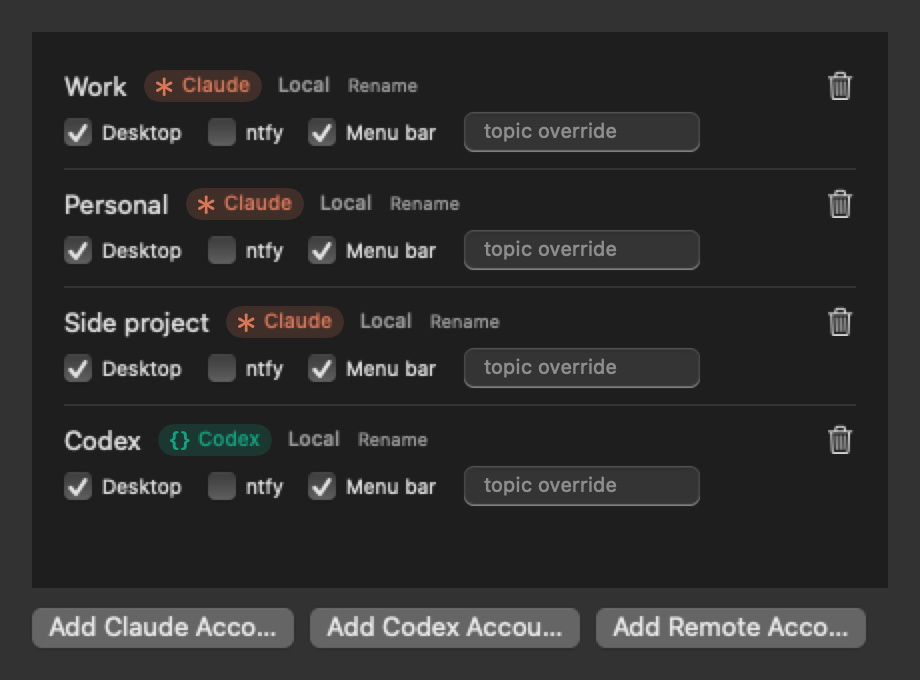
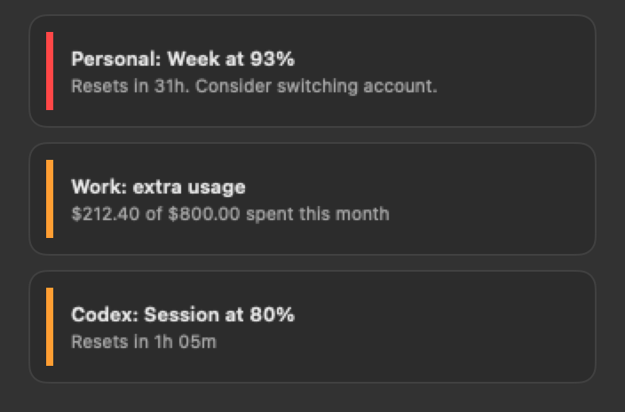

<div align="center">


# Agents Monitor

### Watch your coding agents' usage limits from the menu bar — before you hit them.

A tiny native macOS menu-bar app that polls the usage endpoints **Claude Code** and **Codex**
use themselves, for **any number of accounts of either** on this Mac (or pasted in from another
machine), and alerts you — desktop notification, in-app toast with sound, and
[ntfy](https://ntfy.sh) push to your phone — before a session, weekly, or spend limit runs out
from under you.

[](https://www.apple.com/macos/)
[](#requirements)
[](https://github.com/roypadina/AgentsMonitor/releases/latest)
[](https://swift.org)
[](https://github.com/roypadina/homebrew-tap)
[](LICENSE)
[](https://ko-fi.com/roypadina)

```bash
brew install --cask roypadina/tap/agents-monitor
```

<br>



</div>

---

## What it shows

Per account, straight from the provider's own usage endpoint — the same data behind `/usage` in
Claude Code and the status line in Codex:

- **Session** (5-hour window), **Week**, **Week · Fable** (and any future limit bucket —
  rendering is generic, so new buckets show up automatically, no update needed). Codex accounts
  report the same two headline windows, plus its code-review cap when the plan has one.
- **Extra-usage spend this month** (`$728.60 / $800.00 · 91%`) — Claude accounts only; the Codex
  payload reports a remaining credit balance rather than an amount spent, so there is nothing
  honest to show as spend
- Severity coloring (green / orange / red) — as the API reports it for Claude, graded at the same
  cutoffs locally for Codex, which sends none — a **pacing tick** on
  each bar (where an even burn rate would put you right now), and a "resets in 2h 14m" countdown
- **Usage graphs** — the chart button on a card turns it over: the same rows as graphs over the
  last 24 hours, 7 days or 30 days (the chip in the card's header switches the span). Every poll
  is kept in `~/Library/Application Support/AgentsMonitor/history.jsonl` for 90 days
  <br>
- A **"full in ~7h at this pace"** warning under any limit that will run out before it resets at
  the current burn rate
- A **provider badge** on every account — the agent's mark plus its name, in its own color, with
  the color also running down the leading edge of the card. Settings → General → Accounts picks
  how much shows (icon and name, icon only, name only, hidden) and whether it's colored. The
  color stays on the badge and the stripe: bars and dots mean *severity*, so tinting those by
  provider would read as a health signal
- Menu-bar label, fully configurable (Settings → General + the per-account **Menu bar**
  checkbox): pick **which accounts** appear, **which value** each one shows (worst limit,
  session, weekly, or per-model weekly), plus optional extras per account: the **per-model
  window** shown separately (`F 100%`) and the **extra usage spent** (`$739`)
- A **usage dot** per account that fades green → yellow → red with session/weekly usage, so the
  color alone tells you where you stand. Turn off the percentages and you get a minimal
  dots-only menu bar. Per-model windows never feed the dot or the headline number: with one
  model maxed you can still work on another.

## Accounts

- **Claude, local** — any `CLAUDE_CONFIG_DIR` already logged in on this Mac (`~/.claude`,
  `~/.claude-work`, …). Auto-discovered straight from the keychain, and labeled using the
  email/org in `~/.claude*/.claude.json`. Tokens are read fresh from the keychain on every poll
  and **never refreshed by this app** — refreshing would burn Claude Code's single-use refresh
  token and force that profile into `/login`.
- **Codex, local** — any `CODEX_HOME` signed in with a ChatGPT account (`~/.codex`,
  `~/.codex-work`, …), discovered the same way and labeled with the address in the stored token
  claims. Credentials come from `<CODEX_HOME>/auth.json`, not the keychain, so there is no
  consent prompt to work around. Same no-refresh rule and same reason: OpenAI rotates the
  refresh token on use, so spending it would force `codex login`. An api-key-only login has no
  plan usage behind it and is skipped.
- **Remote** — an account that lives on a *different* machine. Settings → Accounts → **Add
  Remote Account…**, then paste the credentials JSON from the source machine:
  - macOS: `security find-generic-password -s "Claude Code-credentials" -w`
  - Linux: `cat ~/.claude/.credentials.json`

  Remote accounts are Claude-only. Stored in an app-owned keychain item, device-only (no iCloud
  sync). Agents Monitor refreshes
  these tokens itself once they expire. One caveat: if the source machine's own Claude Code also
  refreshes that lineage, one side loses the race and the card falls back to
  *Paste credentials…* — see [the User Guide](docs/USER-GUIDE.md#remote-accounts) for the details.

## Alerts

Fires when the **worse of** your warning/critical thresholds (default 80% / 95%) and the API's
own severity is exceeded — de-duped per limit per reset window, and a drop below threshold
re-arms it. A single failed poll on a local account is treated as a likely token-rotation race,
not a real auth failure: the alert only fires on two consecutive strikes, and the memory of
what's already fired survives an app relaunch.

There's also a dedicated **extra-usage alert**: the moment paid usage starts being consumed
(spend moves at all), you get one notification with the amount and the running monthly total —
then it stays quiet until spending pauses for 30 minutes. That's the signal that a session has
stopped being covered by your plan and started costing money. Toggle in Settings → Alerts.

Three sinks, each toggleable per account in Settings:
- **Desktop** — a standard notification (grant permission once when macOS asks on first launch)
- **ntfy** — a JSON POST to your server/topic, priority 3 (warning) / 4 (critical); each account
  can override the default topic
- **Toast** — a floating panel top-right with a slide-and-fade animation and a sound

<div align="center">

<br><br>

</div>

## Requirements

macOS 14 Sonoma or later · Apple Silicon and Intel (universal binary)

## Install

### Homebrew (recommended)

```bash
brew install --cask roypadina/tap/agents-monitor
```

If your Homebrew asks you to trust third-party casks first: `brew trust --cask roypadina/tap/agents-monitor`.

> [!IMPORTANT]
> **Clear quarantine before the first launch, not after.** The app is ad-hoc signed (not
> notarized), and Homebrew 6 removed `--no-quarantine`, so a cask install always lands
> quarantined. Launching it in that state raises the Gatekeeper dialog whose *default button is
> **Move to Trash*** — answer it by reflex and the app is gone from `/Applications`.
>
> ```bash
> xattr -dr com.apple.quarantine "/Applications/AgentsMonitor.app"   # then launch
> ```
>
> On macOS 15 and later, right-click → Open no longer bypasses Gatekeeper. If the app was blocked,
> open **System Settings → Privacy & Security** and click **Open Anyway**.

### Manual install

Download the latest `AgentsMonitor.zip` from
[Releases](https://github.com/roypadina/AgentsMonitor/releases), unzip, and drag
`AgentsMonitor.app` into `/Applications`.

### Build from source

```bash
git clone https://github.com/roypadina/AgentsMonitor.git
cd AgentsMonitor
xcodebuild -workspace AgentsMonitor.xcworkspace -scheme AgentsMonitor \
  -configuration Release -derivedDataPath build build
cp -R build/Build/Products/Release/AgentsMonitor.app /Applications/
open /Applications/AgentsMonitor.app
```

> Agents Monitor is **ad-hoc signed, not notarized** (no paid Apple Developer ID). On first
> launch macOS will refuse to open it — open **System Settings → Privacy & Security** and click
> **Open Anyway** (macOS 15+), or clear quarantine yourself:
> ```bash
> xattr -dr com.apple.quarantine "/Applications/AgentsMonitor.app"
> ```
> Every line of this app is in this repo — build it yourself if you'd rather not trust a
> prebuilt binary. See [docs/INSTALL.md](docs/INSTALL.md) for the full walkthrough, including
> first-run behavior and uninstalling.

## No keychain prompts

Reading another app's keychain item from an ad-hoc-signed app normally blocks on a consent
dialog. Agents Monitor suppresses that keychain UI and falls back to Apple-signed
`/usr/bin/security`, which created Claude Code's items and passes their keychain partition check
silently — so it works headless, survives rebuilds, and never interrupts you with a password
prompt. Codex keeps its credentials in a file instead, so that path needs none of this.

## Learn more

- [docs/INSTALL.md](docs/INSTALL.md) — install, first run, updating, uninstall
- [docs/USER-GUIDE.md](docs/USER-GUIDE.md) — every screen, every setting, ntfy setup from
  scratch, alert semantics, troubleshooting
- [Wiki](https://github.com/roypadina/AgentsMonitor/wiki) — accounts, alerts, how it works, troubleshooting, FAQ

## Build & test

```bash
swift test --package-path AgentsMonitorKit          # 72 unit tests (parsing for both providers, derivation, alert engine, credentials, settings, menu bar, defaults migration, usage history)
xcodebuild -workspace AgentsMonitor.xcworkspace -scheme AgentsMonitor \
  -configuration Release -derivedDataPath build build
cp -R build/Build/Products/Release/AgentsMonitor.app /Applications/
```

No third-party dependencies. All logic lives in the `AgentsMonitorKit` local SPM package,
independently testable with no keychain or network access required; the app target is thin
SwiftUI (`MenuBarExtra`).

Keychain/OAuth internals adapted from MIT-licensed [CCSeva](https://github.com/Iamshankhadeep/ccseva)
and [Claude-Usage-Tracker](https://github.com/hamed-elfayome/Claude-Usage-Tracker) (see
`docs/reference-ccsync.swift`; attribution headers in `KeychainService.swift` /
`CredentialStore.swift`).

## Debugging / logs

Everything logs to unified logging under subsystem `com.roy.agentsmonitor` (categories: `poll`,
`alerts`, `http`, `credentials`, `notify`). No tokens or credential payloads are ever logged; account display names do appear
in your local log (it never leaves this Mac).

```bash
# live tail
/usr/bin/log stream --predicate 'subsystem == "com.roy.agentsmonitor"' --level debug
# recent history (persisted store)
/usr/bin/log show --last 2h --info --debug --predicate 'subsystem == "com.roy.agentsmonitor"'
```

Alert decisions log as `eval <account>/<limit>: <pct>% level=<new> stored=<old> sameWindow=<bool>
fire=<bool>` — enough to reconstruct why any alert did or didn't fire. Alert de-dupe memory
persists across relaunches (`AgentsMonitor.alertMemory` in `defaults`); delete that key to force
a full re-alert.

Window-roll detection uses a 120s tolerance on `resets_at` because the server recomputes it on
every request (±1–2s observed) — exact comparison caused an alert on every single poll once
(351 phone pushes in 12 hours, before this was caught).

## Privacy

- **What it reads.** Your local Claude Code login (the Keychain items Claude Code created) and your
  local Codex login (`<CODEX_HOME>/auth.json`), **read-only**, only to ask each provider's own
  usage endpoint how much of your limits you have used. It never refreshes, rewrites or deletes
  those logins.
- **What leaves your Mac.** Only those usage requests: `api.anthropic.com` (Claude) and
  `chatgpt.com` (Codex), each carrying that account's own access token. If you turn on **ntfy**,
  alert text (account name, limit, percentage) goes to the ntfy server and topic you configure.
  Nothing else: no analytics, no telemetry, no update checks, no third parties.
- **Remote accounts.** If you paste credentials for an account that lives on another machine, the
  app stores them in its own device-only Keychain item (not iCloud, not UserDefaults, never
  logged). Because it owns that login, it refreshes those tokens itself by calling Anthropic's
  token endpoint (`platform.claude.com`) when they expire. Local accounts are never refreshed.
- **What it keeps on disk.** Your account list and settings in the app's preferences, a usage
  history in `~/Library/Application Support/AgentsMonitor/history.jsonl` (percentages and spend
  per account, 90 days), and a short-lived response cache in `~/Library/Caches/`.
- **Not affiliated.** Agents Monitor is an independent project, not affiliated with, endorsed by
  or sponsored by Anthropic or OpenAI. "Claude" and "Codex" are their products' names. The usage
  endpoints it calls are undocumented and may change or stop working.

## Caveats

- Both usage endpoints are undocumented and unsupported by their vendors. Anthropic's needs the
  `claude-cli/…` User-Agent, and its 180s minimum poll interval comes from community-measured
  rate-limit behavior; the Codex one is `chatgpt.com/backend-api/codex/usage`, sent with the
  headers the CLI itself uses. If polling 429s, the app backs off 3 → 6 → 12 → 15 minutes per
  account.
- Weekly `resets_at` is the server's own naive rolling-window estimate — treat the countdown as
  approximate, not authoritative.
- Not sandboxed, not notarized. It reads another app's keychain item and calls undocumented
  vendor endpoints — both are why. See [Is it safe?](docs/USER-GUIDE.md#is-it-safe) in the
  user guide.

## Support

If Agents Monitor saves you from hitting a usage limit by surprise, you can support its development — it's optional and always appreciated.

[](https://ko-fi.com/roypadina)

A ⭐ on the repo helps just as much.

## License

[MIT](LICENSE) © 2026 Roy Padina — see [LICENSE](LICENSE) for the vendored-code attribution to
CCSeva and Claude-Usage-Tracker · [Support on Ko-fi ☕](https://ko-fi.com/roypadina)
